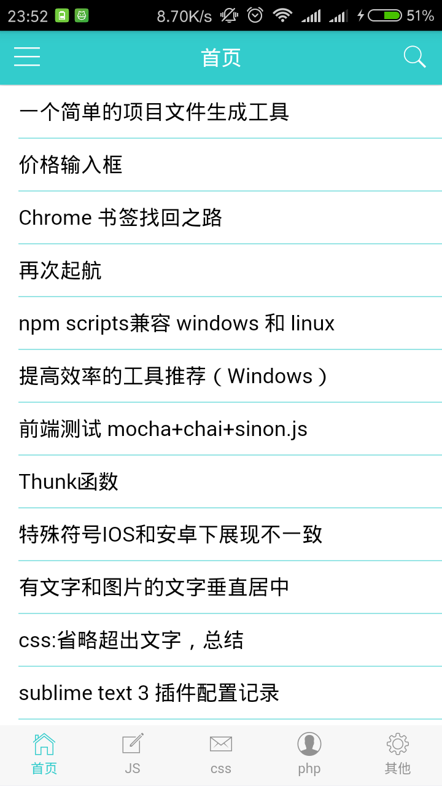
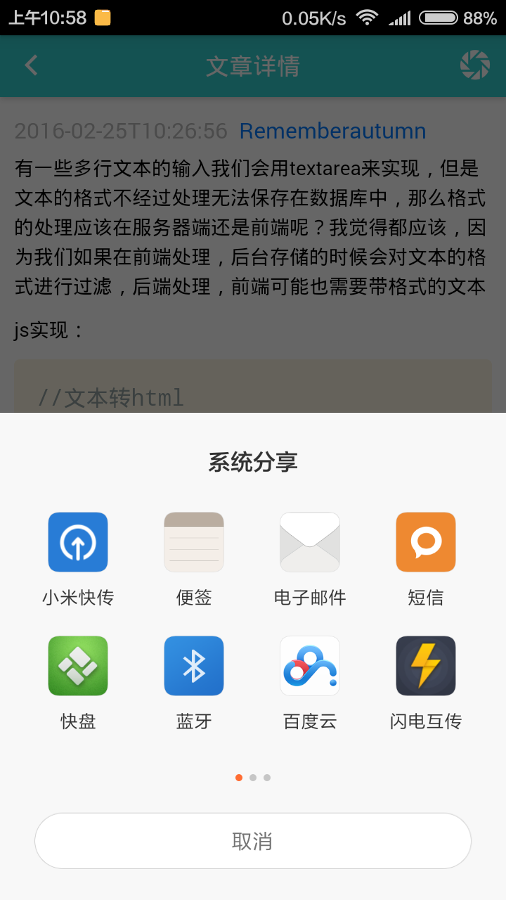
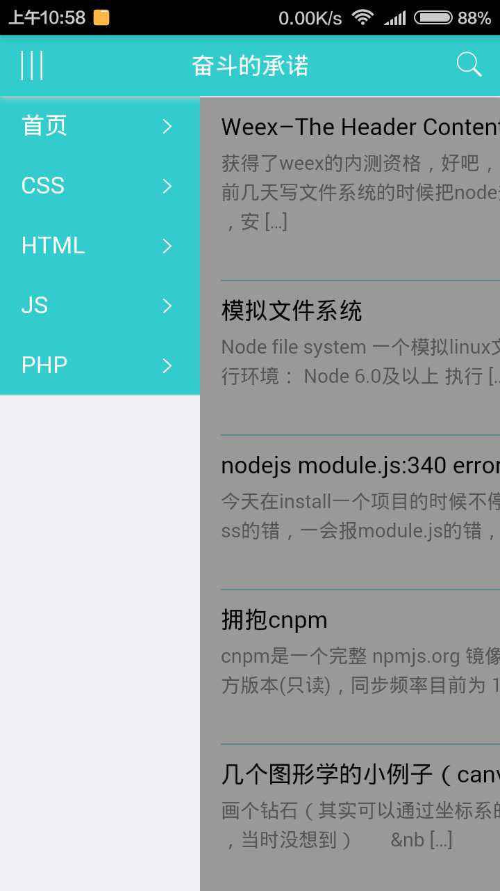
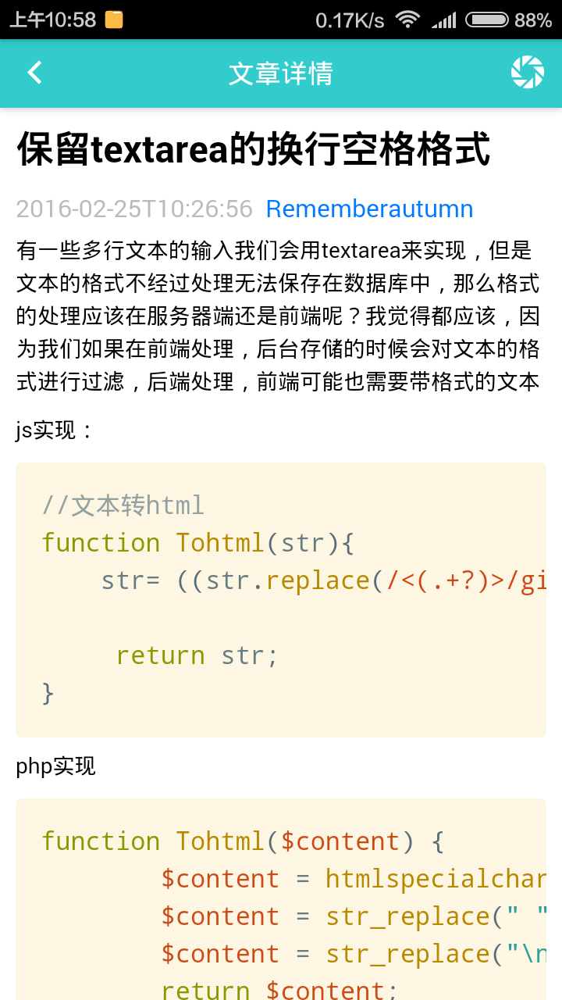
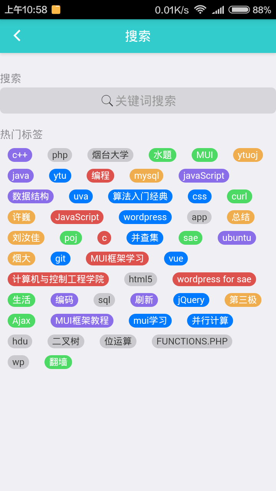

# Wordpress-Mobile-Application
利用`wordpress`作为后台，构建`App`(安卓和IOS)
-------------------
### 更新内容

2026.10.31（第二批）：性能与体验继续优化
- 列表缓存按「栏目 + 页码 + 搜索词」分别存取，切换栏目不再串数据、不再拿旧列表顶新栏目
- 首屏先渲染缓存，再由 `plusReady` 触发刷新：去掉白屏等待与首屏重复请求；请求失败可重试，分页结果自动去重
- 新增骨架屏、空态、错误态，弱网下不再是"白屏无反馈"
- 列表摘要改为纯文本输出（剥标签 + 80 字截断），修掉 Wordpress 摘要 `<p>` 套进 `<p class="mui-ellipsis">` 的非法嵌套（会撑破省略号样式）
- 详情页：标签固定配色不再随机跳色、切换文章自动回顶、正文图片点击可预览、分享标题去 HTML 标签并拦截未加载状态
- 搜索页：最近 6 条搜索历史（本地留存、一点即搜、可一键清空）；中文输入法回车不再误触发搜索
- 新增深色模式（跟随系统 `prefers-color-scheme`），正文图片限宽不再横向溢出
- 内置浏览器页重写：修复"无 Vue 实例导致提示层永不消失"、"空地址白屏"、"返回键无兜底"三个问题

2026.10.31：工程与体验优化
- 修复 `detail.html` 中 `line-height` 缺冒号、`mui-soll` 拼写错误导致正文行高与滚动失效
- 修复 `tags.html` 中 `mui-content=append`、`browser/index.html` 中 `autoShwo` 拼写错误
- 接口返回的 HTML 统一做白名单清洗，防 XSS 注入
- 列表与标签缓存增加 10 分钟过期时间，脏数据不再导致白屏
- 列表首屏去掉 1 秒硬等待，图片启用懒加载并固定缩略图尺寸，避免列表跳动
- 系统分享兼容 iOS（改为 `plus.share`，Android 保留 Intent 回落）
- 清理调试日志、修复隐式全局变量

2017.6.26: 文章列表页增加截图,兼容4.8

2016.10.24: 添加底部菜单栏

2016.10.02: 升级 vue 2.0 版本
2016.05.15：支持代码高亮，支持语言PHP,JS,CSS,Java等，代码格式`<pre class="lang:js">code</pre>`或`<pre class="lang:js"><code>code<code></pre>`,代码高亮使用了prismjs，做了一些修改，如有其它需求可修改此插件。

### 定制 APP

#### 修改主题颜色

下载本项目代码，打开css/mystyle.css最后几行有注释声明可以修改颜色值，修改颜色值即可自定义主题颜色。

#### 修改底部菜单

在`/js/app.js` 中修改 `nav_bar` 数据可以修改底部菜单栏，其中 `class` 为图标样式，可选样式参考 [所有图标](http://dev.dcloud.net.cn/mui/ui/#icon)


### 目录结构

```
├── index.html          # 主框架页（头部 + 侧滑菜单）
├── list.html           # 文章列表（下拉刷新 / 上拉加载）
├── detail.html         # 文章详情（代码高亮 / 分享）
├── tags.html           # 标签与关键词搜索
├── nav_bar.html        # 底部导航
├── browser/index.html  # 站外链接内置浏览器
├── js/
│   ├── app.js          # 全局配置、组件、请求封装、工具函数
│   ├── mui.min.js      # MUI 框架
│   ├── vue.min.js      # Vue 2
│   └── prism.js        # 代码高亮
├── css/                # mui.min.css / mystyle.css（主题色）/ prism.css
├── fonts/              # mui 图标字体
└── manifest.json       # 5+ App 打包配置
```

### 本地调试

无需构建，项目是纯静态页面。用任意静态服务器即可预览（`plus.*` 相关能力需在 HBuilder 真机运行环境中才可用）：

```bash
npx serve .        # 或 python3 -m http.server 8080
```

界面相关调试请用 HBuilderX 的「运行到手机或模拟器」。


-----------------------
### 构建方法
1. 安装`wordpress`

2. 为`wordpress`安装 `wordpress rest api` （2.0版本及以上）

3. 更改`/js/app.js`里面的`name`和菜单名称和对应的`id`（可在`example.com/wp-json/wp/v2/categories`查看）

4. 下载安装`Hbuilder`，使用其在线打包功能，选择文件/打开目录（打开本项目代码目录），双击`manifest.json`设置`app`名称和`id`，修改`app`图标和启动图。

5. 点击发行，发行为原生应用，设置好开发者证书，然后打包。

打包成功后会自动下载到本地目录，这样一个`App`就制作好了。

### 列表页增加图片

当前主题的`functions.php`下添加如下代码即可

```php
// 添加缩略图
add_action( 'rest_api_init', 'add_thumbnail_to_JSON' );
function add_thumbnail_to_JSON() {
//Add featured image
register_rest_field( 'post',
    'featured_image_src', //NAME OF THE NEW FIELD TO BE ADDED - you can call this anything
    array(
        'get_callback'    => 'get_image_src',
        'update_callback' => null,
        'schema'          => null,
         )
    );
}

// 自动缩略图
function get_image_src( $object, $field_name, $request ) {
  $first_img = '';
  $output = preg_match_all('//i', $object['content']['rendered'], $matches);
  $first_img = $matches [1] [0];

  if(empty($first_img)){
    // echo get_bloginfo ( 'stylesheet_directory' );
    // echo '/img/default.jpg';
    $first_img = 'https://wx2.sinaimg.cn/crop.0.60.600.450.240/bc1249d0gy1fpcnyjbd38j20go0go0ta.jpg';
  }
    return $first_img;
}
```


### 案例体验
我的博客：[奋斗的承诺](https://github.com/4013465w/Wordpress-Mobile-Application/blob/master/unpackage/release/myblog_0331140049.apk?raw=true)

### 用到的技术
1. html5+:[http://www.html5plus.org/doc/h5p.html](http://www.html5plus.org/doc/h5p.html)

2. mui:[http://dev.dcloud.net.cn/mui/](http://dev.dcloud.net.cn/mui/)

3. hbuilder:[http://www.dcloud.io/](http://www.dcloud.io/)

### 项目截图

    
   

## 分享交流

打赏|加小助手进微信群
:---:|:---:
  |  

##License

The MIT License (MIT)

Copyright (c) 2016 Zhen.Wang
